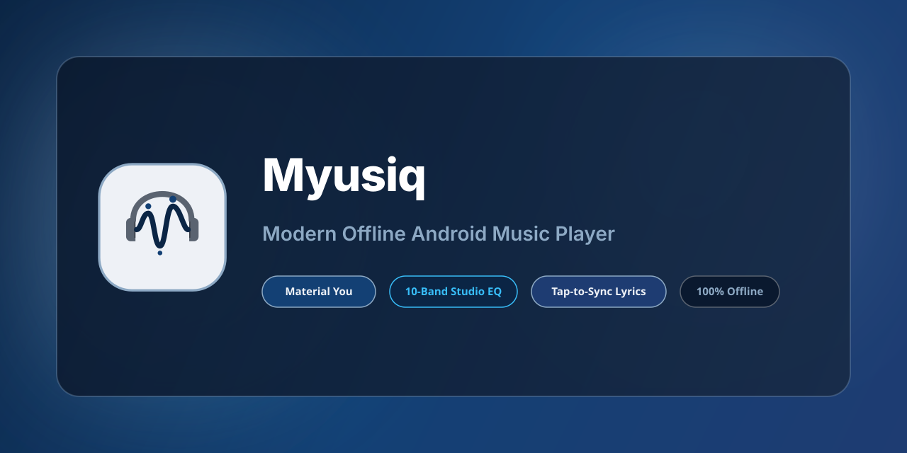
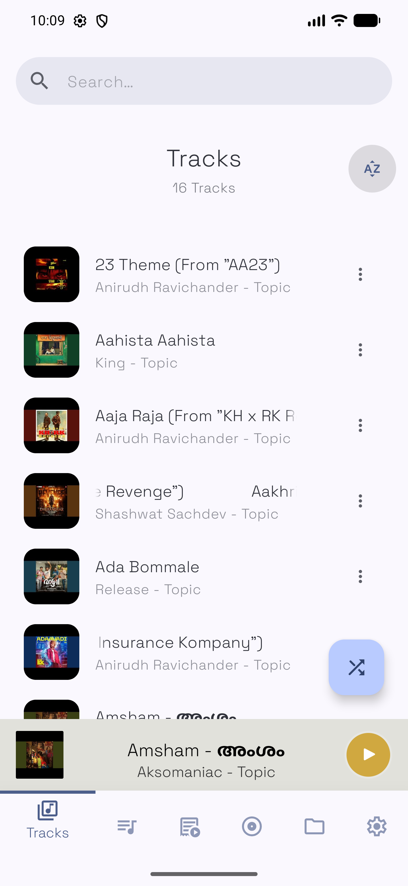
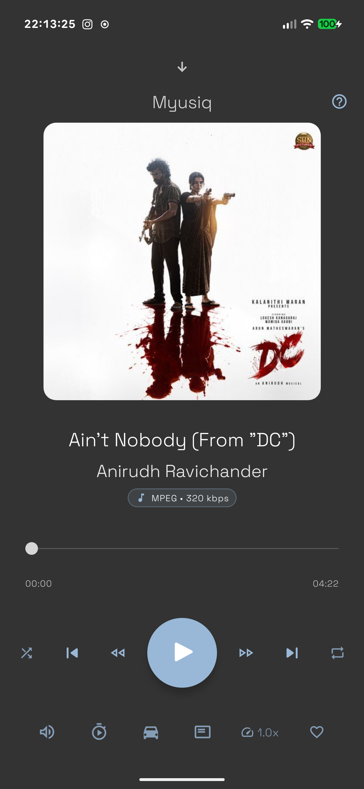
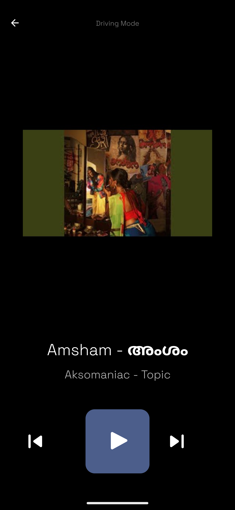
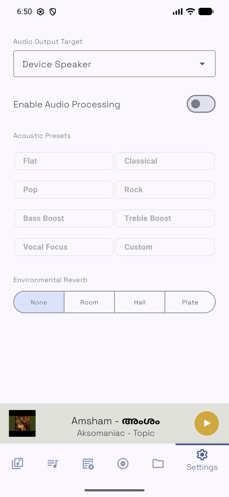
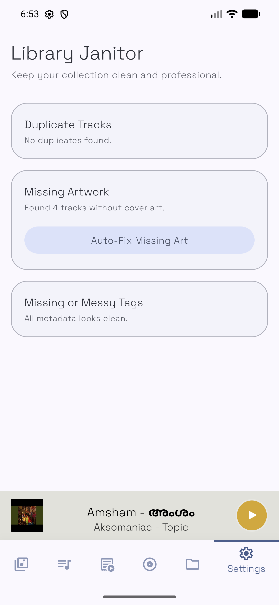
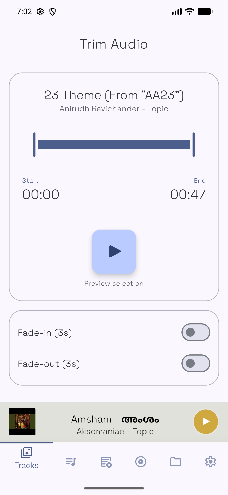

<p align="center">
  
</p>

# Myusiq - Modern Offline Android Music Player

<p align="center">
  <strong>Studio-grade offline audio player for Android with Material You dynamic color extraction, 10-band studio EQ, real-time tap-to-sync lyrics, and zero tracking.</strong>
</p>

<p align="center">
  <a href="https://github.com/sreejith19931/Myusiq-App/releases/latest"></a>
  <a href="https://myusiq.vercel.app"></a>
  <a href="https://t.me/+j2pPQYhxkz1mN2Yy"></a>
  
  
  
</p>

---

<p align="center">
  🌐 <strong>Experience the Interactive Web Showcase:</strong><br>
  <a href="https://myusiq.vercel.app"><strong>myusiq.vercel.app</strong></a> — Features 3D device scroll parallax, live audio wave canvas, and interactive Material You color sandbox.
</p>

---

## 🌟 Visual Showcase

<div align="center">
  <table>
    <tr>
      <td width="33%"></td>
      <td width="33%"></td>
      <td width="33%"></td>
    </tr>
    <tr align="center">
      <td><b>Library & Tracks</b></td>
      <td><b>Now Playing (Hi-Res Badge)</b></td>
      <td><b>Driving Mode</b></td>
    </tr>
  </table>
</div>

<div align="center">
  <table>
    <tr>
      <td width="33%"></td>
      <td width="33%"></td>
      <td width="33%"></td>
    </tr>
    <tr align="center">
      <td><b>10-Band Studio EQ</b></td>
      <td><b>Library Janitor Auto-Fix</b></td>
      <td><b>Audio Trimmer</b></td>
    </tr>
  </table>
</div>

---

## 🚀 Key Capabilities (`v1.4.1`)

* 📲 **Streamlined Permissions & Directory Discovery**: Refined verification wizard, default-deselected folder scanning, native directory browser, and zero-delay folder toggling.
* 🎨 **Material You Expressive Theming**: UI accent colors breathe and extract dynamic swatches live from your active track's album art.
* 🎤 **Tap-to-Sync Lyric Creator**: Interactive timestamp editor to stamp LRC timestamps `[mm:ss.xx]` line-by-line during track playback and embed directly into ID3 tags.
* ⚡ **60fps Visualizer Studio**: Hardware-accelerated visualizer suite featuring 4 audio-reactive modes (*Spectrum Analyzer, Circular Pulse Ring, Liquid Waveform, Particle Field*).
* 🎚️ **10-Band Studio Equalizer**: Precision frequency sliders (`31Hz` to `16kHz`), real-time FFT spectrum analyzer, and hardware AudioFX (`BassBoost`, `Virtualizer 3D`, `PresetReverb`, `LoudnessEnhancer`).
* 🧹 **Library Janitor**: Automated local library health tool that fetches high-res artwork, repairs broken ID3 metadata tags, sanitizes title cases, and groups multi-artist albums offline.
* 🔊 **Audiophile Audio Engine**: Powered by **Jetpack Media3 & ExoPlayer** with EBU R128 ReplayGain volume normalization, dynamic Hi-Res sample rate badges (`96.0 kHz FLAC`), and variable speed/pitch controls.
* 🚗 **Driving Mode & Wear OS**: High-contrast, large-touch driving controls and a companion smartwatch app.
* 🔒 **Zero Tracking Privacy Guarantee**: 100% offline, ad-free, with zero analytics or cloud account requirements.

---

## 🛠️ Tech Stack & Architecture

| Layer | Technology / Library |
| :--- | :--- |
| **Language & Async** | Kotlin 100%, Coroutines (`Semaphore(4)` parallel speedups), StateFlow |
| **UI & Design System** | Material Design 3, Jetpack Compose / Android Views, Dynamic Theme Palette Extraction |
| **Audio Playback Engine** | AndroidX Media3 (ExoPlayer), `PlaybackParameters`, AudioTargetRouting |
| **Audio Processing** | Android Native `AudioEffect` Framework (`BassBoost`, `Virtualizer`, `PresetReverb`) |
| **Tagging & Metadata** | JAudioTagger ID3v2, Shared Public Storage Backups (`.myusiq_backup`) |
| **Caching & Network** | LRU In-Memory Cache (100 entries), iTunes & Deezer Metadata API Resolvers |

---

## 💬 Community & Support

Need help, have feature requests, or want to discuss Myusiq? Join our official community channels:

* 💬 **Telegram Support Chat**: [t.me/+j2pPQYhxkz1mN2Yy](https://t.me/+j2pPQYhxkz1mN2Yy)
* 📢 **Telegram Updates Channel**: [t.me/myusiq_updates](https://t.me/myusiq_updates)
* 🐛 **GitHub Issues**: [Report a Bug](https://github.com/sreejith19931/Myusiq/issues)

---

## 📦 Download & Installation

### Option 1: Direct APK Download (Recommended)
Download the latest signed release APK from GitHub Releases:

👉 **[Download Myusiq-v1.4.1.apk](https://github.com/sreejith19931/Myusiq-App/releases/download/v1.4.1/Myusiq-v1.4.1.apk)**

---

## 📈 Star History

[](https://star-history.com/#sreejith19931/Myusiq&Date)

---

## 📄 License

This project is licensed under the **MIT License** — see the [LICENSE](LICENSE) file for details.

```
Copyright (c) 2026 Myusiq Contributors
```
